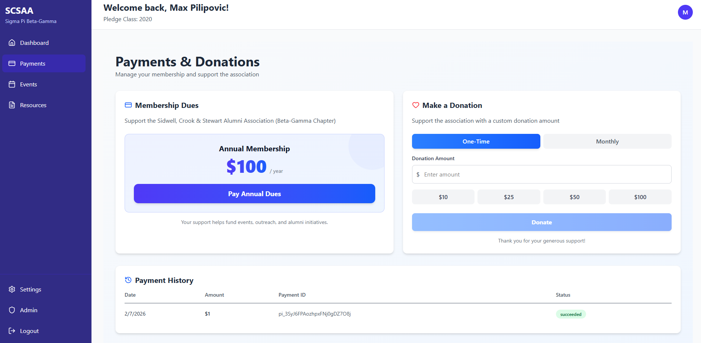
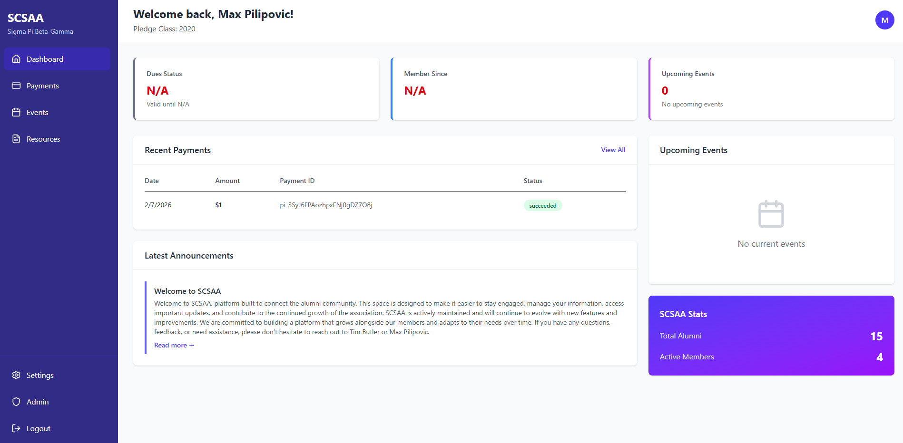

# SCSAA Alumni Association Website

🌐 [scsaa.club](https://scsaa.club)

**Sidwell, Crook, Stewart Alumni Association (SCSAA)**  
A full-stack web application for Sigma Pi Beta-Gamma alumni to register, pay dues, make donations, and access member resources.

Currently used by **100+ alumni members**.

---

## Project Overview

This project provides a centralized web platform for alumni of the Sigma Pi Beta-Gamma chapter to:

- Register and log in securely
- Pay annual dues online
- Make donations
- View payment history
- Access a member dashboard
- Allow admins to manage members and payment statuses

---

## Screenshots

### Payments Page

### Member Dashboard

---

## Tech Stack

| Layer | Technology |
|---|---|
| Frontend | React, Vite, Tailwind CSS |
| Backend | Node.js, Express |
| Database / Auth | Supabase |
| Payments | Stripe |
| Deployment | Render |

---

## Technical Implementation

- Built a responsive single-page application using React and React Router
- Implemented secure authentication with Supabase Auth
- Created protected backend routes using token-based middleware
- Integrated Stripe Checkout for dues and donations
- Built Stripe webhook handling to update payment records
- Designed member and admin dashboard flows
- Deployed the frontend and backend with Render

---

## Purpose

SCSAA was built to modernize alumni management for the Sigma Pi Beta-Gamma chapter by giving members a simple place to manage dues, donations, and account information.
